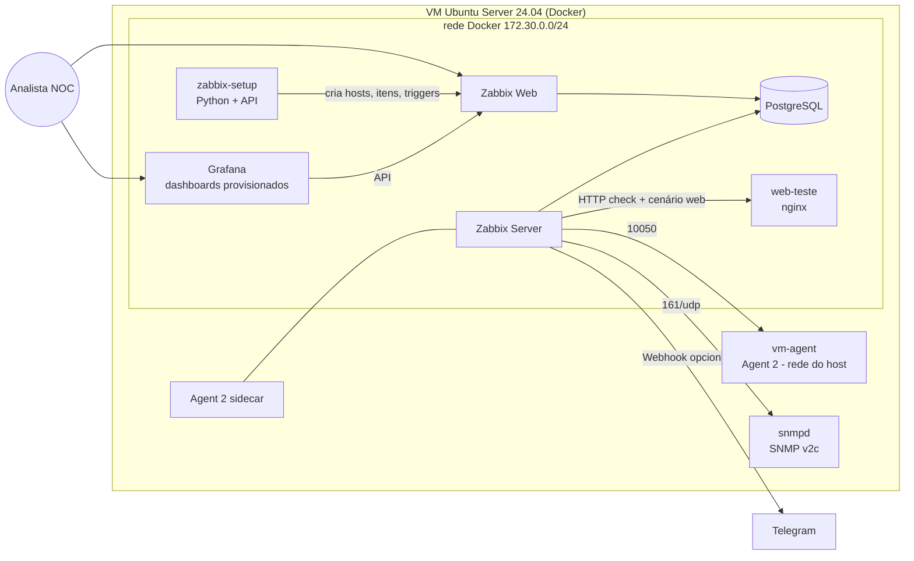
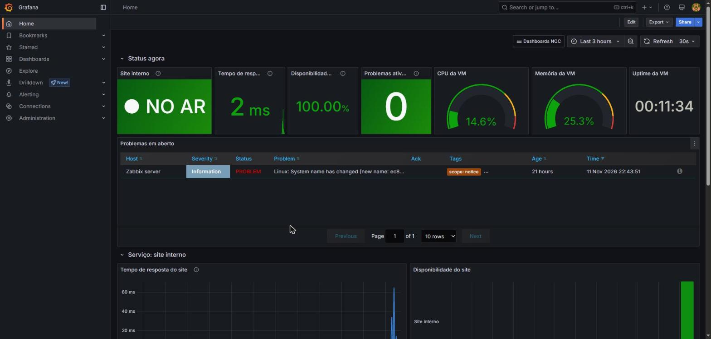
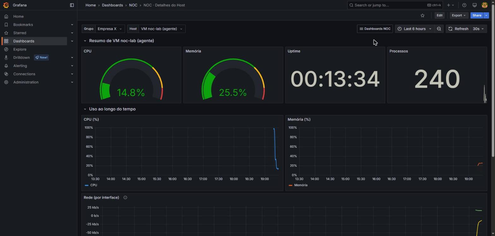
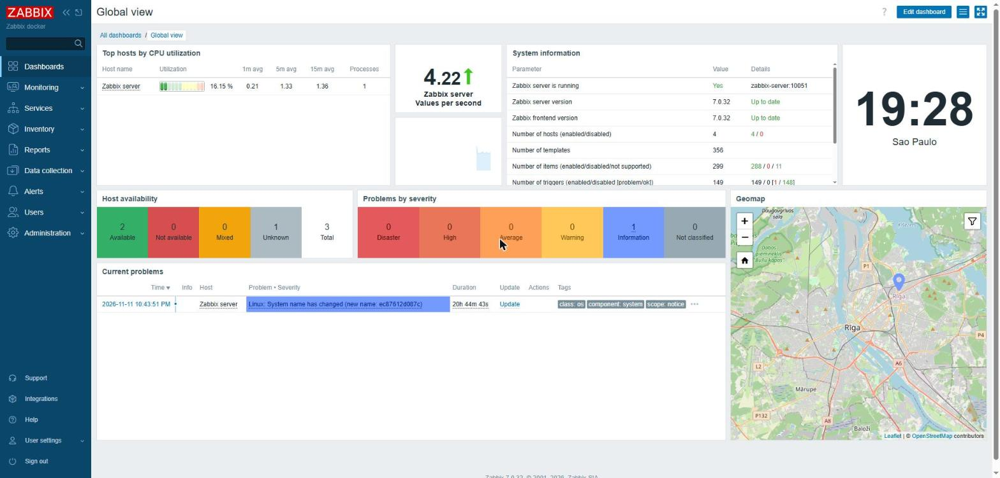
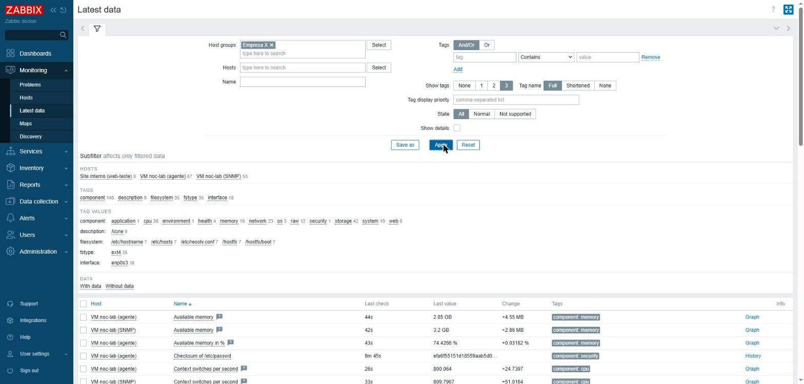

# 01 – NOC: Monitoramento de Infraestrutura com Zabbix + Grafana

Ambiente de NOC em home lab para a **"Empresa X"** (cenário fictício): monitora a VM, um serviço web e a rede, com **alertas, dashboards prontos, runbook e simulador de incidentes**. Tudo sobe com **um comando** e se configura sozinho via API ("monitoramento como código").

## Objetivo
Simular a rotina de um analista de NOC: **monitorar → receber alerta → diagnosticar → resolver → documentar o chamado**.

## Arquitetura



## Tecnologias
Zabbix 7.0 LTS · Grafana 11 (plugin Zabbix) · PostgreSQL 16 · Docker Compose · Zabbix Agent 2 · SNMP v2c (net-snmp) · Python (API JSON-RPC) · Bash · Ubuntu Server 24.04 · VirtualBox

## O que foi implementado
- **Infra como código:** toda a stack em Docker Compose; banco sem porta exposta; senhas fora do Git (`.env`).
- **Monitoramento como código:** `setup/configure_zabbix.py` cria via API, de forma idempotente:
  - host `vm-noc-lab` (Zabbix Agent 2) e `vm-noc-lab-snmp` (SNMP) – a mesma VM por dois métodos;
  - host `site-interno` com **check de porta HTTP**, **tempo de resposta** e **cenário web (HTTP 200)**;
  - triggers por severidade: *fora do ar* (High), *cenário web falhou* (Average), *lento > 0,5s* (Warning);
  - alertas no **Telegram** (opcional – só preencher token e chat ID no `.env`).
- **Dashboards versionados** (gerados por código em `grafana/gerar_dashboards.py`):
  - **NOC · Visão Geral** – telão com status do serviço, problemas em aberto, CPU/memória/uptime, disponibilidade, latência, rede (SNMP) e disco;
  - **NOC · Detalhes do Host** – escolha grupo e host no topo.
- **Runbook** com procedimento para cada alerta: [`docs/RUNBOOK.md`](docs/RUNBOOK.md).
- **Simulador de incidentes** (site fora, site lento, CPU alta, disco cheio): [`scripts/simular-incidentes.sh`](scripts/simular-incidentes.sh).
- **Chamados documentados** no formato de ITSM: [`docs/incidentes/`](docs/incidentes/).

## Prints

| NOC · Visão Geral (Grafana) | NOC · Detalhes do Host (Grafana) |
|---|---|
|  |  |

| Zabbix · Global View | Zabbix · Coleta de dados (SNMP + agente) |
|---|---|
|  |  |

> Capturados do ambiente rodando: serviço no ar, disponibilidade 100%, gauges de CPU/memória/uptime e a coleta ativa dos 3 hosts (site, agente e SNMP).

## Como reproduzir
```bash
cp .env.example .env        # edite as senhas (e o Telegram, se quiser)
docker compose up -d
docker logs -f zbx-setup    # acompanhe a configuração automática (termina com ✅)
```
- Zabbix: `http://IP_DA_VM:8080`
- Grafana: `http://IP_DA_VM:3000` (abre direto no dashboard NOC)

Simular um incidente:
```bash
bash scripts/simular-incidentes.sh
```

Passo a passo completo e explicado: **[GUIA.md](GUIA.md)**

## Lições aprendidas
- **Agente vs. SNMP mostram coisas diferentes:** monitorar a mesma VM pelos dois métodos deixou claro que o **agente** entrega métricas ricas do sistema operacional (processos, memória detalhada, integridade de arquivos) enquanto o **SNMP** dá uma visão mais leve de rede e interfaces. Ter os dois amplia a cobertura.
- **"Conexão recusada" ≠ "host errado":** depois de reiniciar a VM, o stack Docker leva alguns minutos para responder. Aprendi a diferenciar um host no ar com a porta ainda fechada (serviço subindo) de um host realmente inacessível — detalhe que muda totalmente o diagnóstico.
- **O plugin do Zabbix no Grafana filtra pelo nome *visível* do host, não pelo técnico.** Quando os nomes não batem, o painel fica "No data" silenciosamente. Foi a causa de um dashboard vazio que parecia bug e era só configuração.
- **Alerta transitório vs. problema real:** triggers de CPU alta e de "host reiniciado" disparam logo após o boot e **limpam sozinhos** quando o sistema estabiliza. Entender isso evita tratar ruído de inicialização como incidente.
- **Dashboard como código compensa:** gerar os painéis por Python/provisionamento deixou o ambiente reproduzível — desligar e subir tudo de novo não perdeu o trabalho visual.

## Próximos passos
- Migrar SNMP para **v3** (autenticação + criptografia)
- Integrar com SIEM (Wazuh) — projeto 04
- Monitorar roteadores do projeto 06 (OSPF/BGP) via SNMP

---
Autor: **Ariel Cipriano** · [LinkedIn](https://linkedin.com/in/ariel-cipriano) · [GitHub](https://github.com/Cipriano2004)
