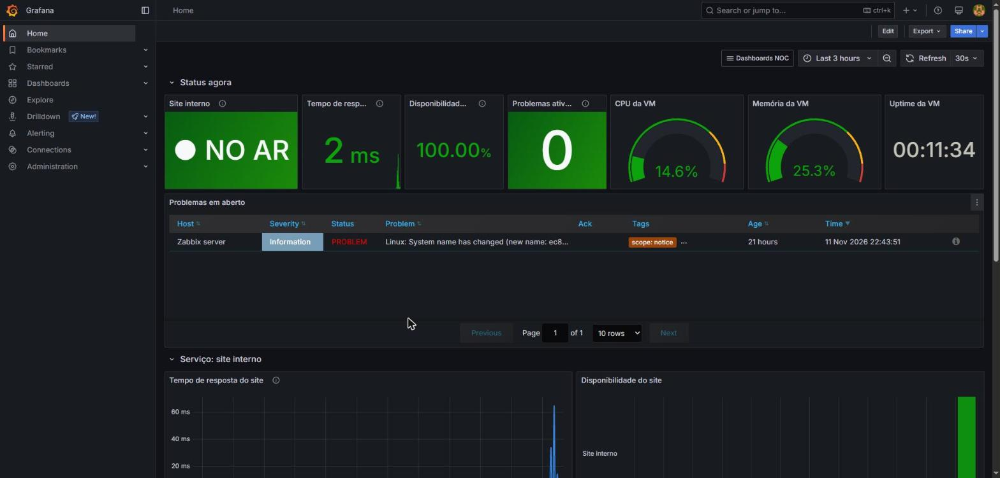

# Chamado INC-0001 – Site interno fora do ar

| Campo | Valor |
|---|---|
| Data/hora da abertura | 11/11/2026 22:15:29 |
| Aberto por | Alerta automático do Zabbix (trigger "Site interno fora do ar") |
| Severidade | **High** |
| Serviço afetado | Site interno da Empresa X (container `web-teste`, porta 80) |
| Responsável | Ariel Cipriano (NOC) |
| Status | Resolvido |
| Data/hora da resolução | 11/11/2026 ~22:20 <!-- confira o horário exato em Zabbix → Monitoring → Problems → History --> |
| Tempo até detectar (MTTD) | **13 segundos** (queda 22:15:16 → alerta 22:15:29) |
| Tempo até resolver (MTTR) | ~5 minutos |

> Incidente **simulado** em laboratório para treinar o processo de NOC
> (`bash scripts/simular-incidentes.sh 1`).

## 1. Alerta recebido
Às 22:15:29 o Zabbix abriu o problema **"Site interno fora do ar"** (severidade High, tag `component: web`) no host *Site interno (web-teste)*.
No Grafana (dashboard **NOC · Visão Geral**) o bloco "Site interno" mudou para **✖ FORA DO AR**, "Problemas ativos" foi para **1** e o bloco "Tempo de resposta" passou a indicar ausência de resposta.

<!-- (opcional) Print do alerta: dashboard "NOC · Visão Geral" com o problema ativo durante a simulação; salve em ../img/inc-0001-alerta.png e troque por  -->

## 2. Impacto
Site interno indisponível para todos os usuários da Empresa X durante aproximadamente 5 minutos.
Demais serviços (VM, banco do Zabbix, Grafana) **não** foram afetados: CPU ~6%, memória ~26%.

## 3. Diagnóstico (seguindo o RUNBOOK – "Site interno fora do ar")
<!-- ATENÇÃO Ariel: os passos 2 e 3 descrevem o resultado ESPERADO. Na próxima simulação,
     rode os comandos de verdade e ajuste o texto com o que aparecer na sua tela. -->

1. Conferi no Zabbix qual item disparou: `net.tcp.service[http,web-teste,80]` retornando **0** (porta 80 sem resposta).
2. Verifiquei o estado do container:
   ```bash
   docker ps -a --filter name=web-teste
   ```
   → status **Exited** (container parado).
3. Verifiquei o log do nginx:
   ```bash
   docker logs --tail 50 web-teste
   ```
   → encerramento normal (sinal de parada), **sem erro de configuração**.
4. **Causa:** container `web-teste` parado (parada manual – simulação de falha).

## 4. Solução aplicada
```bash
docker start web-teste
```
<!-- Na simulação o próprio script religou o serviço ao fim de 5 minutos. Em um incidente real, o comando acima seria a ação do analista. -->

## 5. Validação
- Trigger mudou para **Resolved** no Zabbix.
- Grafana voltou a mostrar **● NO AR**, tempo de resposta ~670 µs.
- Gráfico "Disponibilidade do site" mostra a faixa vermelha do período fora e o retorno ao verde.



## 6. Lições aprendidas / prevenção
- O monitoramento detectou a falha em **13 s** (checagem a cada 30 s) – dentro do esperado.
- O container tem `restart: unless-stopped`, que religa em caso de *crash*, mas **não** em parada manual. Em produção, paradas manuais deveriam passar por **janela de manutenção** registrada no Zabbix (para não gerar alerta falso).
- Para reduzir impacto: ter **redundância** (2 instâncias atrás de um balanceador) e alerta também por **Telegram** para o plantão.
- SLA do período caiu para ~88% por causa da janela curta de dados – reforça a importância de evitar quedas em serviços críticos.
