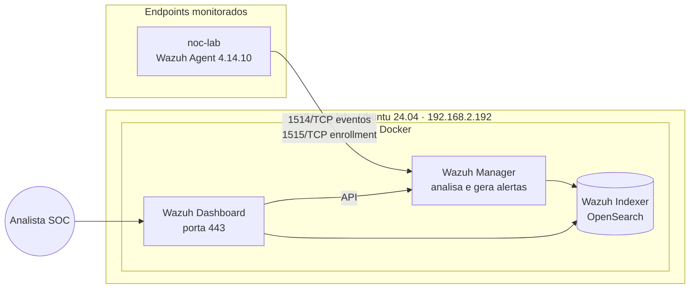
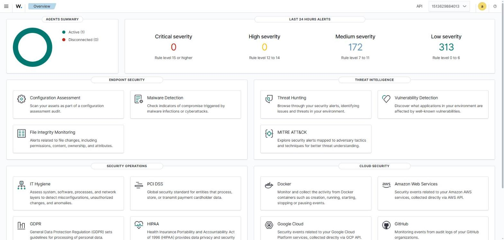
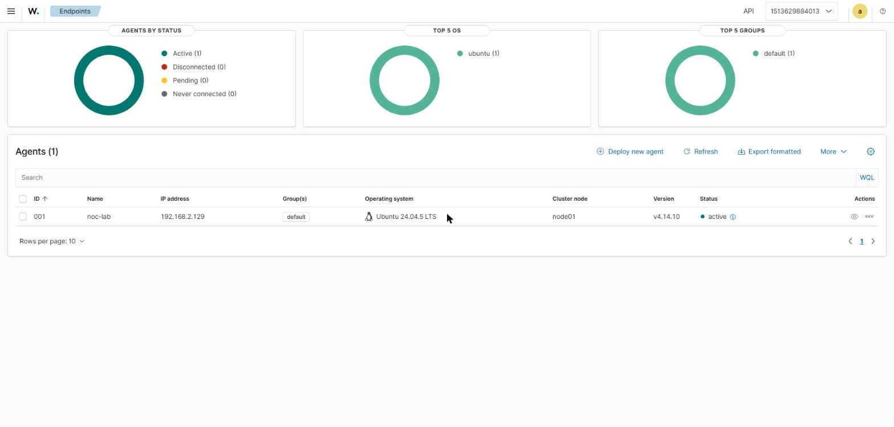
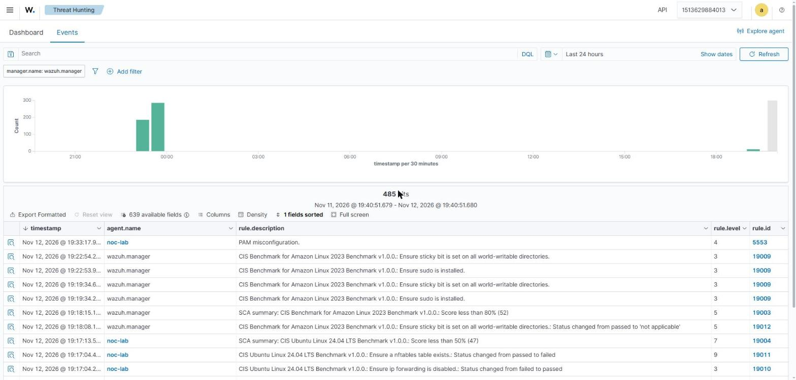
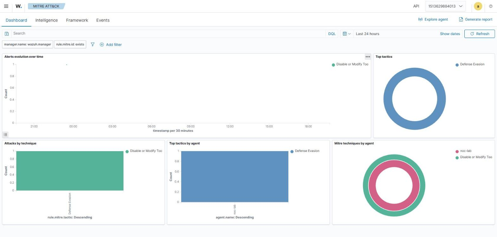

# 04 – SOC: Detecção e Resposta com Wazuh (SIEM/XDR)

SOC em home lab para a **"Empresa X"** (cenário fictício): o Wazuh coleta logs dos endpoints, detecta atividade suspeita e eu investigo cada alerta como um analista N1 — **detectar → investigar → mapear no MITRE ATT&CK → responder → documentar**.

Este projeto é a dupla do [Projeto 01 – NOC](../01-noc-monitoramento). A mesma VM `noc-lab` é monitorada pelo Zabbix (disponibilidade/NOC) **e** pelo Wazuh (segurança/SOC), como numa empresa real.

## Objetivo
Montar um SIEM/XDR, gerar eventos de segurança controlados e produzir **relatórios de incidente** no padrão de um SOC.

## Arquitetura



## Tecnologias
Wazuh 4.14.10 (Manager, Indexer, Dashboard) · Docker Compose · OpenSearch · MITRE ATT&CK · Wazuh Agent (Linux) · TLS entre componentes · Ubuntu Server 24.04 · VirtualBox

## O que foi implementado
- **SIEM completo em Docker Compose** (single-node), com certificados TLS gerados automaticamente entre manager, indexer e dashboard.
- **Instalação como código:** `scripts/instalar-soc.sh` sobe todo o SOC com um comando (Docker, ajuste de kernel, certificados, containers).
- **Endpoint monitorado:** agente Wazuh na `noc-lab` (`scripts/instalar-agente.sh`), com versão travada (`apt-mark hold`) para nunca ficar mais nova que o manager.
- **Testes de detecção** (`scripts/testar-deteccoes.sh`): cinco eventos benignos de administração que, num endpoint monitorado, viram alerta — cada um já mapeado no MITRE ATT&CK. Não atacam outra máquina.
- **Runbook de resposta** por tipo de alerta: [`docs/RUNBOOK.md`](docs/RUNBOOK.md).
- **Relatórios de incidente** no padrão de SOC: [`docs/incidentes/`](docs/incidentes/).

## Testes de detecção e mapeamento MITRE

| # | Evento gerado | Regra Wazuh | Técnica MITRE ATT&CK |
|---|---|---|---|
| 1 | 5 falhas de autenticação (brute force local) | 5503 / 5551 | T1110 – Brute Force |
| 2 | Criação e remoção de usuário | 5902 / 5903 | T1136 – Create Account |
| 3 | `sudo` para comando sensível (ler `/etc/shadow`) | 5402 | T1548 – Abuse Elevation Control |
| 4 | Alteração de arquivo monitorado (FIM) | 550 / 554 | T1565 – Data Manipulation |
| 5 | Binário escondido em `/tmp` | FIM / rootcheck | T1059 – Command and Scripting |

## Prints

| Wazuh · Overview (SIEM) | Agente noc-lab Active (v4.14.10) |
|---|---|
|  |  |

| Threat Hunting · stream de eventos | MITRE ATT&CK |
|---|---|
|  |  |

> Capturados do SOC rodando: 1 agente ativo, alertas das últimas 24h por severidade, centenas de eventos de segurança (SCA/CIS, PAM) e o mapeamento de táticas/técnicas no MITRE ATT&CK.

## Como reproduzir
```bash
# Na VM soc-lab (manager):
bash scripts/instalar-soc.sh
# Acesse: https://IP_DA_SOC  (login inicial admin / SecretPassword – troque depois)

# Na VM noc-lab (endpoint):
bash scripts/instalar-agente.sh 192.168.2.192 noc-lab

# Gerar alertas para investigar:
bash scripts/testar-deteccoes.sh      # menu
```

Passo a passo completo e explicado: **[GUIA.md](GUIA.md)**

## Segurança (importante)
> ⚠️ Este lab usa as **credenciais padrão** do Wazuh (`admin / SecretPassword`), que ficam visíveis no `docker-compose.yml` para facilitar o estudo. **Antes de qualquer uso fora de um ambiente de laboratório isolado, troque todas as senhas** (indexer, API e dashboard) e mantenha-as fora do Git (`.env`/secrets). O `.gitignore` já exclui os certificados TLS gerados.

## Lições aprendidas
- **NOC e SOC respondem perguntas diferentes sobre a MESMA máquina:** o NOC pergunta "está no ar e saudável?"; o SOC pergunta "está acontecendo algo suspeito aqui?". Ver a `noc-lab` nos dois painéis tornou essa diferença concreta.
- **O erro nº 1 ao subir o Wazuh é o `vm.max_map_count` baixo:** sem esse ajuste de kernel, o Indexer (OpenSearch) reinicia em loop. Deixei isso no script de instalação para não esquecer.
- **No `sudo`, o que importa não é o `sudo` em si — é *qual* comando foi rodado.** Ler `/etc/shadow` com um sudo legítimo ainda merece investigação. Isso mudou minha forma de ler alertas: contexto vale mais que o evento isolado.
- **O agente nunca pode ser mais novo que o manager,** ou para de reportar — por isso travei a versão com `apt-mark hold`.
- **Nem todo evento é "ataque":** a maior parte dos eventos iniciais vem do **SCA/CIS Benchmark** (postura de segurança do host), não de atividade maliciosa. Aprendi a separar *achado de configuração* de *alerta de atividade* antes de escalar.

## Próximos passos
- Integrar logs do Windows com Sysmon (no projeto de Identidade)
- Ativar resposta ativa (bloqueio automático de IP em brute force)
- Correlacionar alertas do Wazuh com os incidentes do NOC (Zabbix)

---
Autor: **Ariel Cipriano** · [LinkedIn](https://linkedin.com/in/ariel-cipriano) · [GitHub](https://github.com/Cipriano2004)
